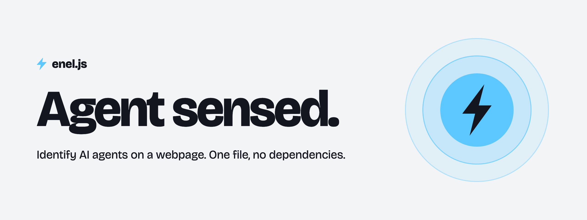

<picture>
  <source media="(prefers-color-scheme: dark)" srcset="assets/banner-dark.png">
  
</picture>

Identify AI agents on a webpage. One file, no dependencies, runs entirely in the browser.

**[Try the live demo](https://ntrossat.github.io/enel-js/)** · [Install](#install) · [Results](#results) · [Signals](#signals) · [Limits](#limits)

Named after Enel, whose Mantra senses every presence on Skypiea.

## Install

```html
<script src="https://cdn.jsdelivr.net/gh/ntrossat/enel-js/enel.js"></script>
```

Or with npm:

```sh
npm install enel-js
```

```js
const Enel = require('enel-js');
```

Or copy `enel.js` into your project.

## Usage

```js
const enel = Enel.start({
  onDetect(result) {
    console.log('AI agent detected', result);
  },
});

enel.result(); // current verdict, at any time
enel.stop();   // remove listeners
```

A result looks like this:

```json
{
  "isAgent": true,
  "confidence": 0.97,
  "agent": "Claude in Chrome",
  "signals": [
    { "id": "dom-marker", "weight": 0.95, "detail": "#claude-agent-stop-container" },
    { "id": "click-without-movement", "weight": 0.45, "detail": "2 click(s) with no pointer travel" }
  ]
}
```

`agent` is `null` when an agent is detected but cannot be named.

For a single check of the environment, with no listeners:

```js
const result = Enel.detect();
```

### Options

| Option | Default | Description |
|---|---|---|
| `threshold` | `0.5` | Confidence at which `isAgent` becomes `true` |
| `onDetect(result)` | | Called once, when the threshold is first crossed |
| `onChange(result)` | | Called every time a new signal comes in |
| `markers` | `[]` | Extra `{ selector, agent }` entries to watch for in the DOM |

A `enel:detect` event is also dispatched on `window`, with the result in `event.detail`.

## Results

Each agent was sent to the demo page to press three buttons and type a word.

| Agent | Detected | Confidence | Named | Signals |
|---|---|---|---|---|
| Claude in Chrome, driven from Claude Code | Yes | 0.80 | No | `click-without-movement`, `robotic-typing` |
| Playwright, headless Chromium | Yes, on load | 0.90 | No | `headless-user-agent` |
| ChatGPT Atlas | Not tested yet | | | |
| ChatGPT agent | Not tested yet | | | |
| Perplexity Comet | Not tested yet | | | |
| Puppeteer | Not tested yet | | | |
| Selenium | Not tested yet | | | |

Last run on 2026-11-20. Tried another agent? Open `index.html`, send it there and add a row.

## Signals

| Signal | Weight | What it sees |
|---|---|---|
| `declared-user-agent` | 1.0 | A user agent that names an AI agent or crawler (ChatGPT-User, Claude-User, Perplexity-User, GPTBot, ...) |
| `dom-marker` | 0.95 | An element a browser agent injects while it is in control |
| `webdriver` | 0.9 | `navigator.webdriver` is `true` |
| `headless-user-agent` | 0.9 | `HeadlessChrome` in the user agent |
| `automation-globals` | 0.9 | Globals left by Playwright, Puppeteer, Selenium and others |
| `click-without-movement` | 0.3 to 0.8 | Mouse clicks that land in new places with no pointer travel in between |
| `robotic-typing` | 0.5 | Keystrokes at near-constant or near-zero intervals |
| `no-languages` | 0.4 | `navigator.languages` is empty |
| `no-window-size` | 0.4 | The outer window measures 0x0 |
| `untrusted-event` | 0.25 | Clicks or key events generated by script |

Weights combine as `1 - product(1 - weight)`, so two weak signals count for more than one.

## Limits

- This is a heuristic. Agentic browsers such as ChatGPT Atlas and Perplexity Comet present themselves as regular Chrome, so only the behavior signals can catch them, and those need the agent to click or type first.
- Everything here runs on the client and can be read and evaded. Do not use it as a security control.
- `untrusted-event` also fires when the page's own code calls `element.click()`, which is why its weight is low.
- Injected markers change as agents are updated. Add new ones through the `markers` option.

## Development

```sh
npm test
```

Open `index.html` in a browser to watch the signals live.

## License

[MIT](LICENSE)
